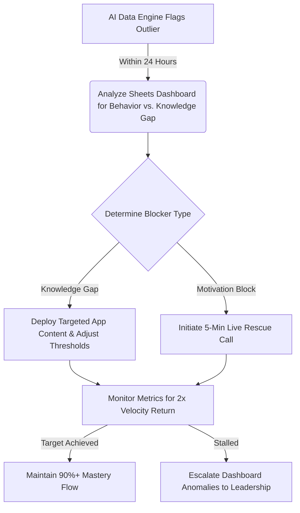

# 🚀 2-Hour Learning: Student Rescue & Data Intervention Dashboard
**A Portfolio Project for the Learning Specialist Role (Crossover / 2 Hour Learning)**

This project demonstrates a production-ready workflow for a **Learning Specialist** handling the *Alpha Anywhere* network. It models how to transform AI-generated performance data into immediate, 48-hour student interventions that drive learners toward **90%+ mastery**.

---

## 📊 Phase 1: The Automated Academic Data Dashboard
Below is the structural layout of the automated Google Sheets tracking system used to surface student learning anomalies dynamically.

### 1. Master Student Analytics Table
*   **A2:A21:** `Student_ID` (e.g., STU-001 to STU-020)
*   **B2:B21:** `Grade_Level` (K-8)
*   **C2:C21:** `Target_Mastery_%` (Set strictly to `0.90`)
*   **D2:D21:** `Actual_Mastery_%` (Current automated platform metrics)
*   **E2:E21:** `Avg_Daily_Minutes` (Time spent per day inside the learning app)
*   **F2:F21:** `Velocity_Trend` (Calculated trajectory of lesson completion speed)

### 2. Core Dashboard Formulas Employed
To dynamically monitor anomalies and separate mechanical errors from true knowledge gaps, the following logic models are embedded in the sheet:

*   **Automated Anomaly Alert (Column G):**
    ```excel
    =IF(OR(D2<0.80, E2<20), "🚨 RESCUE REQUIRED", "✅ Flow Stable")
    ```
    *Logic: Instantly flags any K-8 student whose active mastery falls below 80% or whose daily app focus drops under 20 minutes.*

*   **Dynamic Student Profile Lookup:**
    ```excel
    =XLOOKUP("STU-004", A2:A21, D2:F21, "Student Record Not Found")
    ```
    *Logic: Pulls instant live metrics (Mastery, Minutes, Trend) during a rapid-response triage scenario.*

---

## 🤖 Phase 2: Professional AI Workflows (Generative Prompts)
To scale intervention design, Generative AI (ChatGPT/Claude) is integrated directly into the professional workflow to build tailored coaching framework templates.

### The System Prompt
```text
Context: You are an expert K-8 Learning Specialist at 2 Hour Learning. 
Your objective is to help students double their learning velocity, restore self-belief, 
and resolve immediate academic blocks within a 48-hour window.

Data Input:
- Student: STU-004 (Grade 5)
- Anomaly: Math mastery dropped from 91% to 64% over a 3-day window.
- Behavioral Metric: Average app interaction time dropped from 35 mins to 14 mins.
- System Assessment Note: Repeatedly failing the "Fractions to Decimals" post-assessment block.

Task:
1. Formulate a 2-step root-cause hypothesis distinguishing a physical knowledge gap from a motivation/executive function block.
2. Draft a precise, high-empathy script for a 5-minute live "Rescue Call" that restores confidence and clears the barrier.
```

### AI Output Generated & Validated
*   **Root-Cause Analysis:** The sudden drop in app interaction time alongside a localized assessment failure strongly implies a **motivation/executive-function block** triggered by frustration with a specific concept (Fractions to Decimals), rather than a generalized learning decline.
*   **5-Minute Live Rescue Call Script:**
    *   *0:00 - 1:30 (Empathy & De-escalation):* "Hey [Name]! I was looking at your streak this week—you absolutely crushed those earlier math levels! I noticed the platform threw a bit of a curveball at you with Fractions today. Those are notoriously tricky. How did it feel when you hit that section?"
    *   *1:30 - 3:30 (Blocker Dissolution):* Let's take one problem together. Let's separate the mechanical error. Look at 1/4. If a whole dollar is 100 cents, what is a quarter? Exactly, 25 cents or 0.25. You didn't lose your math skills; the app's wording just threw off your flow!
    *   *3:30 - 5:00 (Re-entry to Flow):* "I'm adjusting your dashboard threshold to give you 3 fresh practice loops on this specific block. Go back in with that same confidence. I’m monitoring your dashboard—you've got this!"

---

## ⚡ Phase 3: The 48-Hour Systematic Intervention Protocol



1.  **Surfacing:** Machine data logs performance drop -> Sheets logic flags an anomaly -> Learning Specialist triages within 24 hours.
2.  **Execution:** Run the targeted AI-generated call protocol to split structural errors from motivation fatigue. 
3.  **Automation & Scale:** Feedback the intervention results to leadership to optimize dashboard thresholds and refine the evolving AI tutor backend.
